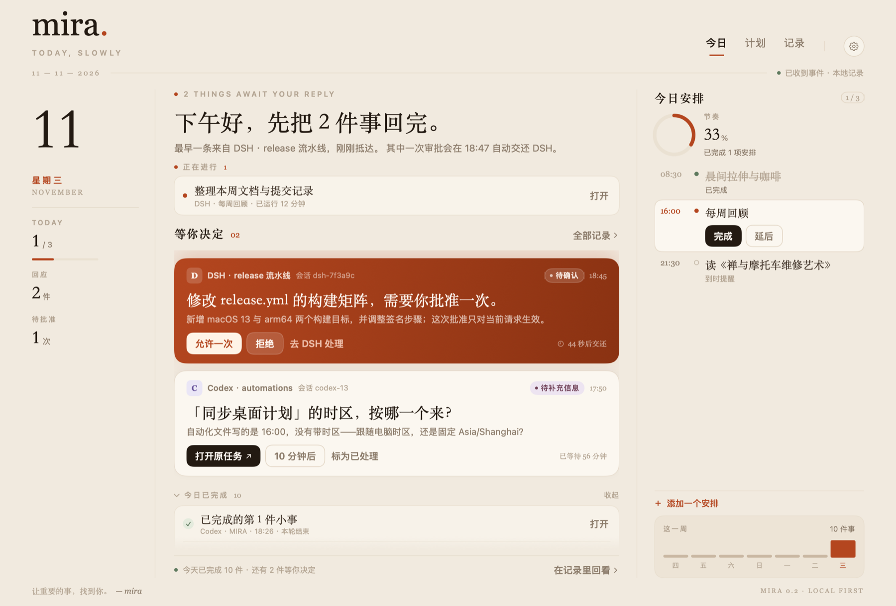
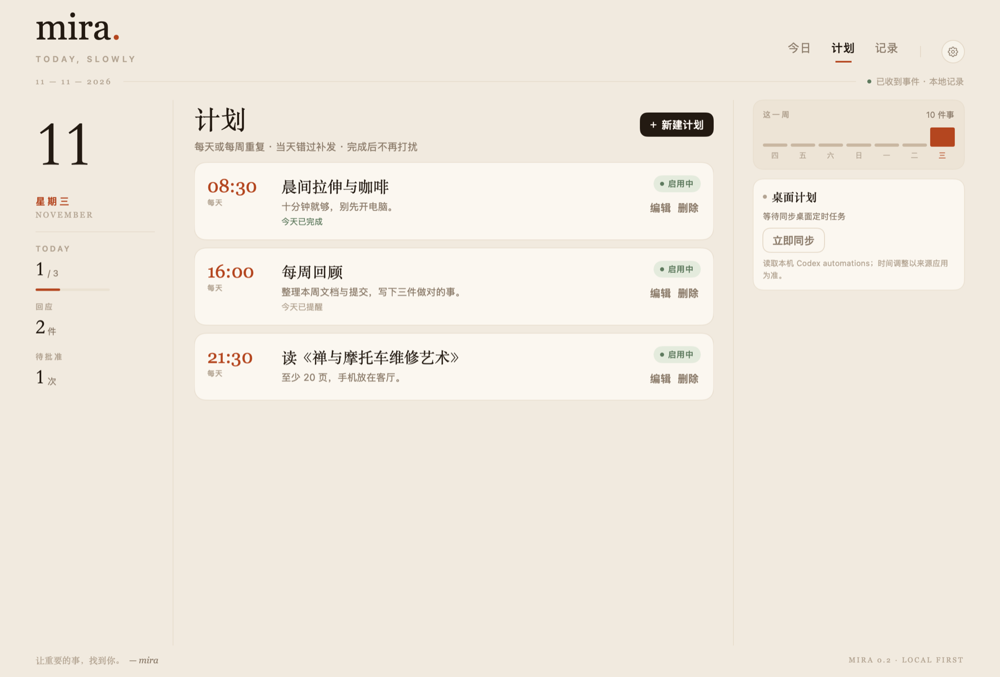
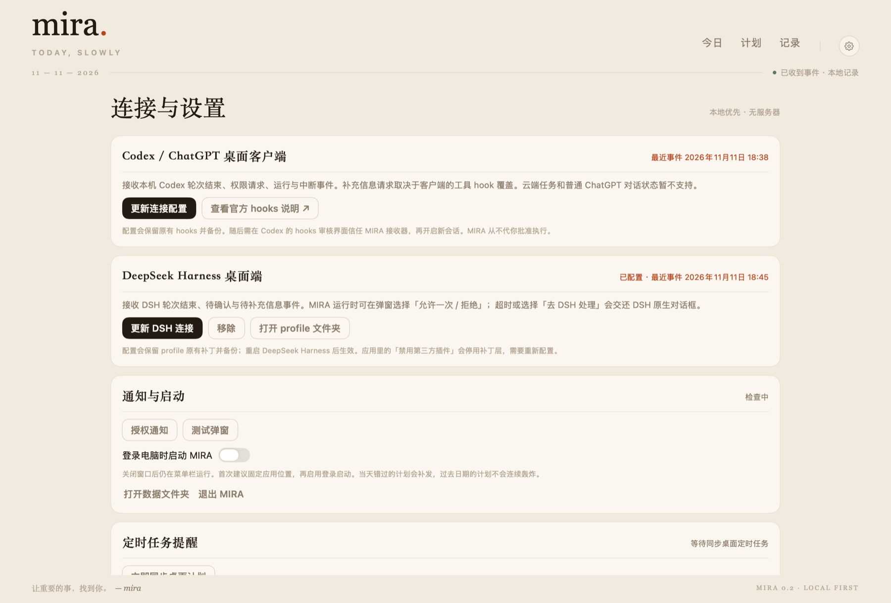
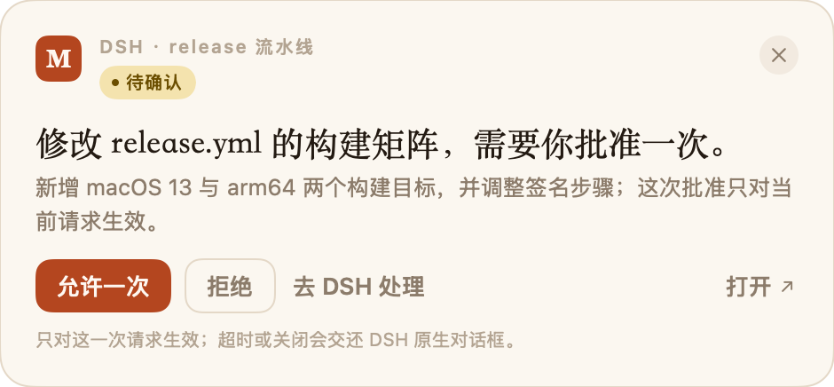
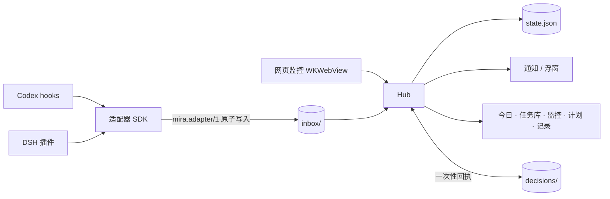

<div align="center">

<h1>MIRA · AI Task Hub</h1>

<p><strong>让重要的事，找到你。</strong></p>

<p>AI 在跑，但结果散落在终端、聊天窗和课程网站里。<br>
MIRA 是一个常驻 macOS 菜单栏的本地任务中心：把 Codex 与 DeepSeek Harness 的轮次、审批，课程作业、网页变化和个人计划，收进同一个本地工作台。</p>

<p>
  
  
  
  
  
</p>

<p>
  <a href="#快速开始">快速开始</a> ·
  <a href="#功能特性">功能特性</a> ·
  <a href="#界面预览">界面预览</a> ·
  <a href="#接入-ai-客户端">接入 AI 客户端</a> ·
  <a href="#架构">架构</a> ·
  <a href="#路线图">路线图</a>
</p>

<a href="docs/images/today.png"></a>

</div>

> **0.2.0 · 开发版**　当前只提供源码构建；产物是本机 ad-hoc 签名，未公证，也没有预编译发行版。macOS 13+，当前构建针对 Apple Silicon。

## 为什么是 MIRA

正在运行的 AI 会不断产出三类东西：**结论**、**等你决定的请求**、**需要你补充的信息**。它们通常埋在某个会话里，关掉窗口就找不到了。课程作业和网页更新又在另一个浏览器标签里。

MIRA 不做新的 AI 客户端，也不接管执行。它只做三件事：

- **收拢**：外部 AI 客户端通过 `mira.adapter/1` 事件进入本地收件箱，课程与网页抓取由应用内同步器直接写入任务库——最终都落在同一份本地状态里。
- **判断**：标题清洗、去重、同会话合并、链接白名单、24 小时静默、审批关闭，全部在 Swift 端做一次。
- **呈现**：今日页优先留下「等你决定」和「今天要做」；其余进入任务库、计划、监控和记录。

三条边界贯穿整个应用：**本地优先**（没有服务器、API Key 和遥测）、**提醒而不代做**（不替你批准命令、不代交作业）、**连接可验证**（设置页直接读已安装适配器的版本，收到真实事件才显示「最近事件」）。

## 功能特性

### 今日：先处理等你决定的事

- 顶部状态带展示最多 3 条正在进行的轮次，含运行时长和「打开」入口。
- 「等你决定」聚合待确认、待补充信息和中断/失败的本轮结束；卡片上可直接打开原会话、延后或标为已处理，DSH 审批则多出「允许一次 / 拒绝」。
- 右侧是今日安排、完成环和本周节奏；个人计划只在这里出现，不在消息流里重复。
- 没有数据时展示空状态，不填充演示内容。

### 任务库：接住没有立刻做完的事

- 快速添加只要求标题；分类、描述、真实截止日期、重点、置顶和关联链接都可以后补。
- 默认分类为课程 / 科研 / 生活 / 未分类；自定义分类可新增、重命名、删除，删除后任务回到「未分类」。
- 支持关键词搜索，按分类、状态、重点、截止日期筛选，按截止日期或最近更新排序；置顶任务始终在前。
- 任务可关联 ChatGPT、Codex、GitHub 或普通网页链接，沿用本机链接校验白名单。
- 完成、归档、恢复、删除都有对应操作；已完成和已归档任务分别进入独立视图，可随时恢复。

### 计划与提醒：按本机时间发生

- 每天或每周固定时刻的个人计划，采用电脑当前时区；当天错过会在启动/唤醒后补发，跨天不追发。
- 启动时和每 30 秒只读同步 `$CODEX_HOME/automations/*/automation.toml`（默认 `~/.codex/automations`），把桌面端定时任务带入「计划」页。
- 可操作的提醒卡提供完成、10 分钟后延后和关闭；本轮结束通知只提醒一次并进入记录。系统通知未授权时回落到 MIRA 自己的浮动卡片。
- 启用登录启动后，默认弹出最多 5 项未完成任务的待办浮窗（可在设置关闭）；菜单栏星形图标在等待确认或补充信息时显示数量。
- 关闭窗口不退出，点击菜单栏图标直接回到「今日」。

### 记录：提醒过去之后仍然可查

- 每轮结束、失败、中断、审批和提问都会留下记录，按时间倒序展示。
- 已处理/已过期记录保留 90 天、最多 500 条；超出部分先按月导出为 `records-YYYY-MM.md`，再从 `state.json` 移除。
- 待确认、待补充、待完成的事项不参与清理。
- 同一会话的新事件会关闭旧提醒；重复投递靠稳定的 `dedupeKey` 去重。

## 界面预览

今日页见上方。计划、连接与设置、审批弹窗沿用同一套暖纸版式（点击图片查看原图）：

<table>
  <tr>
    <td width="50%"><a href="docs/images/plans.png"></a></td>
    <td width="50%"><a href="docs/images/settings.png"></a></td>
  </tr>
  <tr>
    <td align="center"><sub>计划：每天/每周固定时刻，同步 Codex 桌面自动化</sub></td>
    <td align="center"><sub>连接与设置：Codex、DSH、课程来源与通知</sub></td>
  </tr>
</table>

<p align="center">
  <a href="docs/images/reminder.png"></a><br>
  <sub>DSH 审批：允许一次 / 拒绝 / 去 DSH 处理；超时或关闭会交还原生对话框。</sub>
</p>

## 快速开始

### 环境要求

| 项目 | 要求 |
| --- | --- |
| 系统 | macOS 13 Ventura 或更新 |
| 芯片 | 当前构建与验证为 Apple Silicon；Intel 未验收 |
| 工具链 | Xcode Command Line Tools（含 Swift；本机验证 Swift 6.3.1） |
| 运行时 | 系统 `/usr/bin/python3`（Codex hook）；Node.js 由 DSH 自身提供 |

### 构建与启动

仓库不提供预编译包，直接从源码构建：

```sh
git clone https://github.com/luo-qing-xin/MIRA.git
cd MIRA
bash scripts/build.sh
open dist/MIRA.app
```

`scripts/build.sh` 会编译全部 Swift 源码、把 Python/Node 桥接文件放进 app 资源、校验产物的最低系统版本（macOS 13），最后做本机 ad-hoc 签名。产物在 `dist/MIRA.app`。

### 第一次运行

1. 点击菜单栏星形图标打开主窗口，默认停在「今日」。
2. 进入「连接与设置」→「授权通知」→「测试弹窗」，确认提醒通道可用。
3. 按需连接 Codex 或 DeepSeek Harness，见下一节。
4. 若要开机自启：先把 app 放到固定位置，再在设置里启用「登录电脑时启动 MIRA」，并在系统设置的登录项中允许。
5. 关闭窗口不会退出应用；点击菜单栏图标可随时回来。

> 当前产物只做 ad-hoc 签名，没有公证和自动更新，不适合作为面向公众的二进制发行版。

## 接入 AI 客户端

| | Codex | DeepSeek Harness |
| --- | --- | --- |
| 接入方式 | 本机 `~/.codex/hooks.json` hooks | 桌面 profile 的第三方插件 |
| 安装 | 设置页「配置本机连接」 | 设置页「配置 DSH 连接」或 `bash scripts/install-dsh-bridge.sh` |
| 观察 | 轮次结束、权限请求、中断、提示词 | 轮次结束、审批、提问 |
| 审批 | 打开原会话处理；另有后台计划确认 | 弹窗「允许一次 / 拒绝 / 去 DSH 处理」 |
| 深链 | `codex://threads/<session>` | `dsh://open`（聚焦主窗口） |

两个接入共用同一套事件契约和 `ADAPTER_VERSION`（当前 `0.4.0`）。设置页会显示「旧版 / 需要 0.4.0 / 已更新但需重启 / 最近事件」四种状态；更新适配器后，Codex 需新开会话，DSH 需重启。

### Codex

安装时会保留 `~/.codex/hooks.json` 里的其他 hooks 并备份原文件。安装后必须在 Codex 的 hooks 审核界面手动信任 MIRA 接收器——MIRA 不修改信任记录，也不会返回批准、阻断或继续决定。

- **`Stop` 只代表这一轮结束**，不保证目标完成或成功。
- `PermissionRequest` 会触发后台状态核对；只有在真实存在待人工处理的工具审批时才弹窗。
- 事件标题优先取本轮提示词首段；读不到时回退到会话名或项目名。
- 后台计划确认会重新读取请求和模型设置，内容变化时要求重新确认；命令、文件、权限类型的回传目前只有模拟验证，按钮保持禁用。

### DeepSeek Harness

```sh
# 安装
bash scripts/install-dsh-bridge.sh

# 卸载
bash scripts/uninstall-dsh-bridge.sh
```

安装脚本把桥接插件复制到 `~/.dsh/profiles/desktop/plugins/mira-bridge/`，再往 `cordis.patch.yml` 追加一行 `mira-bridge`；改动前会备份原补丁，其他配置保持不动。

- 只挂载在 DSH 桌面 profile；`dsh web`、`headless` 不会加载。
- 审批弹窗只在 MIRA 存活且心跳新鲜时出现，回执是一次性 token、60 秒过期；关闭弹窗、超时或选「去 DSH 处理」都会立即交还 DSH 原生对话框。
- 没有「始终允许」；回执只作用于当前这一条请求。
- `dsh://open` 目前只会把 DSH 主窗口切到前台，不能精确跳到某个会话；弹窗同时显示会话标题和短标识作为兜底。

### 提醒标题怎么来

适配器只交出提示词首段（≤160 字符）。MIRA 统一清洗并裁成 44 字标题（头 28 + 尾 12），缓存在 `title-cache.json` 24 小时，供本轮后续的结束、中断和审批事件复用。读不到提示词时才回退到会话标题或「项目名 · 第 N 轮」。完整提示词不会进入 MIRA。

## 课程与网页监控

统一入口在「监控 → 添加教学系统 / 网页」。识别到 UniCourse、666、学习通网址时，可直接打开对应专用连接；其他系统在内置浏览器登录后配置通用读取规则，不需要学校提供 API。

| 来源 | 登录 | 同步内容 | 去重键 |
| --- | --- | --- | --- |
| UniCourse | RUC 统一身份认证（MIRA 内置窗口） | 首页课程、未提交作业与截止时间；公告单独提醒 | `unicourse:cno:hno` |
| 学习通 | 手机号 / 扫码 | 未交作业与考试；列表里出现截止时间才写入日期 | `chaoxing:work:...` / `exam:...`，无 id 时用标题+链接哈希 |
| RUC 教学系统（666） | 教学系统账号 | 未结束的考试、结束时间与考试链接 | `teaching:<考试 id>` |
| 通用网页 | 内置浏览器登录 | 列表新增、明确提交、已知截止时间变化 | 监控 id + 条目稳定键 |

三个课程来源共用同一组同步档位：30 分钟（默认）/ 1 小时 / 2 小时 / 12 小时 / 1 天 / 7 天。只在 MIRA 运行且电脑唤醒时检查。

- **首次同步建立基线，不发新作业通知**；之后只提醒新增、明确提交和已知截止时间的变化。
- UniCourse 与学习通在网页上提交后，下一次同步会把对应任务自动标为已完成；666 的考试结束后只归档，不代判是否交卷。网页监控只在页面明确显示「已提交」时自动完成，条目单纯消失不算。
- 任一入口读取失败或登录过期时，保留整轮上次结果并显示失败位置，不把不完整结果当成功。
- 课程来源的配置与登录态都留在本机；页面改版时会在数据目录留下诊断样本用于校准。

### 通用网页监控

1. 在「监控」页添加网址；需要登录的页面在内置浏览器里自己完成登录。
2. 点「扫描此页」，选中重复列表容器，再为标题、截止时间、状态指定子元素或相对 CSS 选择器。
3. 如有「下一页」，配置按钮并设置页数上限（默认 20）；终页需要按钮消失、隐藏或禁用。
4. 点「验证当前页字段」核对预览，保存后遍历所有入口建立基线。
5. 之后新增条目、页面明确显示已提交、已知截止时间变化会同步到任务库；监控卡会显示入口和分页覆盖数量。

支持同源 iframe 的手填框架和字段选择器。跨域 iframe、Shadow DOM、Canvas、无限滚动和复杂多步导航尚不支持；iframe 内点选字段暂不支持。

### 可靠性设计

- 检查会等待导航完成、可见加载提示消失，并要求抽取结果连续稳定；单页等待上限 45 秒。
- 空列表必须有明确空状态文字，否则整轮按失败处理。
- 每次检查成功后才提交结果；检查期间修改了配置，旧结果直接丢弃。
- 任务库保存失败时不推进已见条目基线。
- 无链接作业在同一课程内标题唯一时沿用历史身份；重名存在歧义时不强行合并。

第三阶段的 AI 首次识别、通用操作学习和页面改版自动修复尚未实现。

## 架构



应用是单进程的 SwiftUI / AppKit 菜单栏工具。`Hub` 在主线程协调收件箱、调度、通知、窗口和原子状态写入；适配器只通过本地 JSON 文件投递事件，不直接读写 `state.json`。没有服务端、远程数据库或网页前端。

### 事件契约

- 所有通过事件接入的客户端（Codex、DSH 以及以后的新工具）只产出一个 `mira.adapter/1` 事件：`adapter`、`kind`、`session`、`turn`、`cwd`、`titleHint`、`reason`、`link`、`dedupeKey`、`approval` 等字段。完整定义见 [`integrations/contract/adapter-event.md`](integrations/contract/adapter-event.md)。
- `kind` 目前有六种：`turn.start`（运行中）、`turn.end`（本轮结束 / 失败 / 中断 / 拦截 / 达上限）、`approval.asked`、`question.asked`、`approval.closed`、`question.closed`。
- SDK（`integrations/emit/mira_emit.py` 与 `emit.js`）负责补协议信封、压缩提示词和原子落盘；MIRA 是唯一接收方，标题、去重、链接校验和审批关闭只实现一次。
- 旧版适配器直接写完整提醒 JSON 的格式仍然接受；未知字段会被 SDK 丢弃，未知 `kind` 会被忽略并消费。
- 接入一个新工具通常只需要写字段映射，约 40 行。

### 目录结构

```text
Sources/                 SwiftUI / AppKit 单进程应用
  App.swift              Hub：收件箱、调度、通知、窗口
  Core.swift             状态、记录保留、归档、DSH 安装
  TaskCore.swift         任务模型与 schema 迁移
  AdapterContract.swift  事件归一化、标题、去重、链接白名单
  Views.swift            今日 / 计划 / 记录
  TaskLibraryView.swift  任务库
  WebWatch*.swift        网页监控
integrations/
  codex/                 hooks 接收器与 IPC 桥
  dsh/                   DSH 插件
  emit/                  Python / Node SDK
  contract/              事件契约
scripts/                 build、DSH 安装/卸载
tests/                   Swift / Python / Node 测试与 fixtures
```

## 数据与隐私

所有状态都在本机：

```text
~/Library/Application Support/MIRA/
├── state.json            计划、记录、去重键与任务库（schema 2，原子写入）
├── web-watches.json      网页监控规则与已见条目哈希（0600）
├── unicourse.json        UniCourse 会话 Cookie（0600）
├── chaoxing.json         学习通会话 Cookie（0600）
├── teaching.json         666 教学系统会话 Cookie（0600）
├── title-cache.json      本轮 44 字标题（24 小时过期）
├── records-YYYY-MM.md    按月导出的旧记录
├── decisions/            一次性审批回执（0700 / 0600）
├── inbox/                适配器投递队列；rejected/ 存放无法解析的事件
└── heartbeat             DSH 审批前检查的存活心跳
```

- 不连接云端、不需要 API Key、没有遥测；网络请求只发生在课程/网页抓取和打开外部链接时。
- 提示词只保留首段（≤160 字符）进入收件箱，MIRA 再裁成 44 字标题；不保存完整提示词、命令或凭据。
- 登录态由 WebKit 或 0600 配置文件保管；MIRA 不保存密码。
- 记录保留 90 天、最多 500 条；待处理项永不参与清理；旧记录先按月导出再移除。
- 单进程单写者；`state.json` 原子写入，保存失败会保留待写标记并在下一轮重试。

## 开发与测试

```sh
# 构建
bash scripts/build.sh

# Python：适配器、契约、接收器与 DSH 安装脚本
python3 -m unittest discover -s tests -p 'test_*.py'

# Node：DSH 桥接与网页取数脚本
node --test tests/test_dsh_bridge.mjs
node --test tests/test_webwatch_script.mjs
```

Swift 测试按模块拆分，直接用 `swiftc` 编译测试入口：

<details>
<summary>展开 Swift 测试命令</summary>

```sh
CACHE=/tmp/mira-swift-cache

swiftc -module-cache-path $CACHE Sources/Core.swift Sources/TaskCore.swift Sources/AdapterContract.swift tests/CoreTests.swift -o /tmp/mira-core-tests && /tmp/mira-core-tests
swiftc -module-cache-path $CACHE Sources/Core.swift Sources/TaskCore.swift Sources/AdapterContract.swift Sources/ScheduledTasks.swift tests/ScheduledTasksTests.swift -o /tmp/mira-schedules-tests && /tmp/mira-schedules-tests
swiftc -module-cache-path $CACHE Sources/Core.swift Sources/TaskCore.swift Sources/AdapterContract.swift tests/TaskLibraryTests.swift -o /tmp/mira-task-tests && /tmp/mira-task-tests
swiftc -module-cache-path $CACHE Sources/Core.swift Sources/TaskCore.swift Sources/AdapterContract.swift Sources/WebCookie.swift Sources/SyncInterval.swift Sources/UniCourse.swift tests/UniCourseTests.swift -o /tmp/mira-unicourse-tests && /tmp/mira-unicourse-tests
swiftc -module-cache-path $CACHE Sources/Core.swift Sources/TaskCore.swift Sources/AdapterContract.swift Sources/WebCookie.swift Sources/SyncInterval.swift Sources/Chaoxing.swift tests/ChaoxingTests.swift -o /tmp/mira-chaoxing-tests && /tmp/mira-chaoxing-tests
swiftc -module-cache-path $CACHE Sources/Core.swift Sources/TaskCore.swift Sources/AdapterContract.swift Sources/WebCookie.swift Sources/SyncInterval.swift Sources/TeachingSystem.swift tests/TeachingSystemTests.swift -o /tmp/mira-teach-tests && /tmp/mira-teach-tests
swiftc -module-cache-path $CACHE Sources/Core.swift Sources/TaskCore.swift Sources/AdapterContract.swift Sources/SyncInterval.swift Sources/WebWatch.swift tests/WebWatchTests.swift -o /tmp/mira-webwatch-tests && /tmp/mira-webwatch-tests
swiftc -target "$(uname -m)-apple-macos13.0" -D MIRA_TESTING -parse-as-library -module-cache-path $CACHE Sources/*.swift tests/HubReliabilityTests.swift -o /tmp/mira-hub-tests && /tmp/mira-hub-tests
```

</details>

测试覆盖事件入箱、标题与去重、记录保留与归档、计划补发、任务库事务、三套课程解析、网页监控，以及收件箱故障和通知回退。完整的实机验收步骤见 [`docs/ACCEPTANCE.md`](docs/ACCEPTANCE.md)。

## 故障排查

- **设置页显示「旧版」或「→ 需要 0.4.0」**：点对应更新按钮，Codex 新开会话，DSH 重启后再看状态。
- **Codex 没有事件**：确认 `~/.codex/hooks.json` 中有 MIRA 接收器，并在 Codex 的 hooks 审核界面信任它；不要在未审核时绕过。
- **DSH 没有事件**：先启动一次 DSH，再运行安装脚本；确认只在使用桌面 profile，`dsh web` 不会加载插件。
- **审批没有出现在 MIRA**：MIRA 必须存活；心跳超过 15 秒或弹窗超时（约 60 秒）都会回落到 DSH 原生对话框。
- **系统通知没弹出**：检查系统通知权限和勿扰模式；提醒仍会保留在任务中心和记录里。
- **课程同步提示登录过期**：在设置页点「重新登录」；登录态只保存在本机，不会上传。
- **网页监控读不到列表**：确认页面是同源 iframe、列表有明确空状态，且登录没有过期；页面改版后按诊断样本重新校准。

## 已知限制

- 仅支持 macOS；Windows 尚未实现。当前构建为 Apple Silicon，Intel 与 macOS 13 实机启动未验收。
- ChatGPT 云端 Tasks 尚未接入；桌面自动化只同步本机 `automation.toml`，支持每天/每周的单个固定时刻，不支持月度、间隔多周或小时循环。
- Codex 的 `Stop` 只能确定「轮次结束」，不能可靠区分任务失败；权限回传除计划执行外仍处于模拟验证阶段。
- MIRA 不会修改会话内容，也不会自动批准命令；审批必须由人决定。
- DSH 只接入桌面 profile；`dsh://open` 只聚焦主窗口，不能定位到具体会话。
- 网页监控的第三阶段（AI 识别、操作学习、自动修复）未实现；跨域 iframe、Shadow DOM、Canvas、无限滚动等页面暂不支持，也未在所有学校验收。
- 应用为单进程、单写者；ad-hoc 签名，未公证，无自动更新。

## 路线图

- [ ] 并发审批合并到同一浮窗，支持同批多请求的集中处理
- [ ] 今日页直接展示今天到期和逾期的任务
- [ ] 记录页只读查看按月归档的 `records-*.md`
- [ ] 网页监控第三阶段：AI 首次识别、操作学习、页面改版自动修复
- [ ] Codex 命令、文件和权限审批的真实回传验收
- [ ] macOS 13 实机、Intel 构建与公开分发验收
- [ ] 更多 AI 客户端适配器

## 文档

- [适配器事件契约 `mira.adapter/1`](integrations/contract/adapter-event.md)
- [完整启动验收清单与真实连接范围](docs/ACCEPTANCE.md)
- [项目审查与优化建议](PROJECT_AUDIT.md)
- [持续改进日志](OPTIMIZATION_LOG.md)
- [构建脚本](scripts/build.sh)

## 贡献

欢迎通过 Issue 报告问题或提出建议。提交 PR 前请先运行[开发与测试](#开发与测试)中的命令，并保持 `mira.adapter/1` 契约的向后兼容。

## 参考

- [官方 Hooks 事件、信任与执行语义](https://learn.chatgpt.com/docs/hooks)
- [官方桌面插件生命周期 hooks](https://developers.openai.com/plugins/build/plugins)

## 许可

本仓库尚未声明开源许可证，默认保留所有权利。

<div align="center">
<sub>让重要的事，找到你。 · MIRA 0.2 · LOCAL FIRST</sub>
</div>
